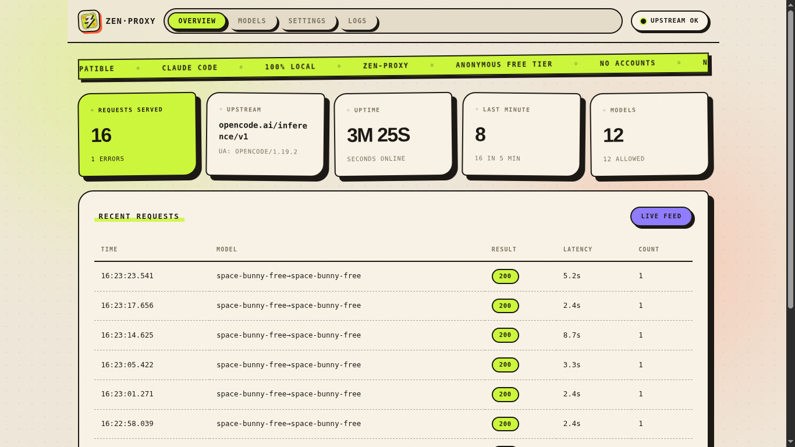

<p align="center">
  
</p>

<p align="center"><b>zen-proxy</b></p>
<p align="center">Use OpenCode Zen's free models from any AI coding agent.</p>
<p align="center"><sub>No account. No API key. OpenAI&nbsp;and&nbsp;Anthropic&nbsp;compatible. Runs on your machine.</sub></p>

<p align="center">
  <a href="LICENSE"></a>
  
  
  <a href="#any-openai-compatible-agent">
    
  </a>
  <a href="#claude-code">
    
  </a>
</p>

---

## Start here

### Install

```bash
curl -fsSL https://raw.githubusercontent.com/12errh/zen-proxy/main/install.sh | bash
```

```powershell
irm https://raw.githubusercontent.com/12errh/zen-proxy/main/install.ps1 | iex
```

<sub>That is the entire installation — no account, no API key, no `npm install`. Now pick your agent below.</sub>

---

### Claude Code

```bash
zen-claude
```

<sub>Identical on Linux, macOS and Windows.</sub>

It starts the proxy if it is not already running, loads every live free Zen model into Claude Code's `/model` picker, runs Claude Code, and stops the proxy again when you exit. Your existing Claude Code config is never touched.

---

### Any OpenAI-compatible agent

<sub>Cline, Roo Code, Continue, Aider, mimo, opencode forks — anything with a `baseURL` setting.</sub>

| Setting | Value |
|---|---|
| Base URL | `http://127.0.0.1:8787/v1` |
| API key | `public` |
| Model | anything from `GET /v1/models` |

Confirm the proxy is up:

```bash
curl -s http://127.0.0.1:8787/health
# {"ok":true,"upstream":"https://opencode.ai/inference/v1"}
```

<details>
<summary>Run the proxy yourself</summary>

```bash
zen-proxy     # http://127.0.0.1:8787 — dashboard at /
```

It stays up until you stop it, so you point your agent at it once and keep using it. `zen-claude` does this for you and cleans up after.
</details>

---

## What you get

| | |
|---|---|
| `POST /v1/chat/completions` | OpenAI, streaming and not |
| `POST /v1/responses` | OpenAI Responses API, translated both ways |
| `POST /v1/messages` | Anthropic Messages API — **this is the Claude Code one** |
| `POST /v1/messages/count_tokens` | Anthropic token estimate |
| `GET /v1/models` | What's live right now |
| Automatic fallback | Retries the next free model on `429` / `5xx` / unavailable |
| Model aliases | Call it `gpt-4o`, get a free model back |
| Auth | Anonymous `Bearer public`, or bring your own Zen key |
| Dashboard | `http://127.0.0.1:8787/` |

The free-model catalog in [`models.json`](models.json) is refreshed from OpenCode's public catalog by a GitHub Action every 6 hours.

---

## Why a proxy is needed

OpenCode's free models are served only to the OpenCode CLI itself. Everyone else gets:

```
403 FreeTierError: OpenCode's free tier can only be used from within OpenCode
```

zen-proxy sits in front of that gateway and identifies your agent as a real session.

<details>
<summary>What it actually changes</summary>

| Gateway requirement | What zen-proxy does |
|---|---|
| `x-opencode-session` **and** `x-opencode-session-id`, same value | Mints a stable per-client id and sends both |
| The id must look real — its first 12 hex chars encode a timestamp | Generates ids in OpenCode's own format, not random hex |
| Base must be `https://opencode.ai/inference/v1` | Uses it, and migrates configs still pointing at the retired `/zen/v1` |
| Streaming, a system message, tool definitions | Real agents already send these; the proxy fills gaps where it can |

For `/v1/messages` specifically, the gateway also requires OpenCode's own tool manifest, so zen-proxy attaches those tools alongside Claude Code's and renames the resulting calls back. **Claude Code's system prompt is passed through untouched.**

The OpenAI-shaped routes get no name mapping, so they are handled differently: a request carrying **no tools at all** — an agent's own internal call, like summarization or title generation — is given OpenCode's own tool manifest so it passes the gate, exactly as opencode sends it on every call. The gateway does not honour `tool_choice: "none"` — it answers a plain summarization prompt with real `read` calls — so any tool call is stripped from the reply instead, on both OpenAI-shaped routes.
</details>

<details>
<summary>Gotchas worth knowing before you file a bug</summary>

- **This rides an anonymous free tier.** Per-IP quotas, shared pool, sometimes saturated. Bring a key if you need reliability.
- **A bare `curl` gets `403`.** The gateway only answers genuine *agent* traffic. Every agent above does this; a hand-rolled chat client won't.
- **A model marked "agent-only" is not broken.** The gateway refuses synthetic health probes, so the proxy learns real health from your actual requests — `ok (live traffic)`. Models are never dropped on a temporary block.
- **Model existence comes from the catalog, not from probing.** A retired model and a healthy one are refused identically, so no probe can tell them apart.
- **Fallbacks announce themselves** via `zen_served_by` and the `x-zen-served-by` / `x-zen-fallback` headers.
- **`agent-tools.json` is a capture of OpenCode's tools.** If OpenCode changes its tool schemas, the `/v1/messages` bridge may stop satisfying the gateway. Re-capture it from any OpenCode request.
</details>

---

## Configuration

`zen-proxy.json`, created on first run, hot-reloaded, and editable from the dashboard. Environment variables override at startup.

<details>
<summary>Keys</summary>

| Key | Default | Description |
|---|---|---|
| `host` / `port` | `127.0.0.1` / `8787` | Bind address (restart required) |
| `upstream` | `https://opencode.ai/inference/v1` | Zen gateway base |
| `ua` / `autoUA` | `opencode/1.18.30` / `true` | User-Agent sent upstream; auto-tracks OpenCode releases |
| `injectSession` | `true` | Mint and send the session header pair |
| `agentTools` | `true` | Attach OpenCode's tools to `/v1/messages`, and to tool-less requests on the OpenAI-shaped routes |
| `defaultModel` | `""` | Empty = auto-pick the first working free model |
| `fallbackModels` | *(from [`models.json`](models.json))* | Tried in order on failure. Omit to follow the catalog; save once to pin your own list |
| `modelAliases` | `{}` | e.g. `{"gpt-4o": "space-bunny-free"}` |
| `responsesModels` | `["gpt-5*","gpt-6*","grok-*","muse-spark-*"]` | Models served on `/v1/responses`; patterns may end in `*` |
| `defaultZenKey` | `""` | Your own Zen key instead of anonymous `public` |
| `proxyKey` | `""` | Require this from clients; also locks the dashboard and `/api/*` |
| `rateLimitMax` / `rateLimitWindowMs` | `0` (off) / `60000` | Per-client rate limiting |
| `timeoutMs` / `cacheMs` | `120000` / `30000` | Upstream timeout, `/v1/models` cache TTL |
| `autoSync` / `autoSyncIntervalMs` | `true` / `3600000` | Runtime discovery of newly-offered free models |
| `trustForwarded` | `false` | Honour `x-forwarded-for` behind a reverse proxy |

`HOST` `PORT` `ZEN_URL` `ZEN_UA` `INJECT_SESSION=0` `AUTO_UA=0` `UA_REFRESH_MS` `AGENT_TOOLS=0` `PROBE_AUTH` `DEFAULT_MODEL` `FALLBACK_MODELS` `MODEL_ALIASES` `RESPONSES_MODELS` `PROXY_KEY` `ZEN_KEY` `TRUST_FORWARDED=1` `TIMEOUT_MS` `CACHE_MS` `RATE_LIMIT_MAX` `RATE_LIMIT_WINDOW_MS` `AUTO_SYNC=0` `AUTO_SYNC_MS` `ZEN_PROXY_CONFIG`

Anonymous `public` access shares a per-IP quota that is sometimes saturated. Set `defaultZenKey`, or send `x-zen-key` per request, for steadier service.
</details>

<details>
<summary>Dashboard</summary>

`http://127.0.0.1:8787/` — upstream health and uptime, a live request feed, one-click model testing, instant config editing, and a log tail.


</details>

<details>
<summary>HTTP API</summary>

| Method | Path | Description |
|---|---|---|
| `POST` | `/v1/chat/completions` | OpenAI Chat Completions |
| `POST` | `/v1/responses` | OpenAI Responses API |
| `POST` | `/v1/messages` | Anthropic Messages API |
| `POST` | `/v1/messages/count_tokens` | Anthropic token estimate |
| `GET` | `/v1/models` | Available models |
| `GET` | `/health` | Health check (always open) |
| `GET` | `/` | Dashboard |
| `GET`/`PUT` | `/api/config` | Read / update configuration |
| `GET` | `/api/status` | Stats and upstream health |
| `POST` | `/api/test` | Test one model — `{"model":"..."}` |
| `GET` | `/api/logs` | Log tail |
| `POST` | `/api/sync` | Re-run model discovery |
| `POST` | `/api/reset` | Reset request statistics |
</details>

<details>
<summary>Running as a service (Linux)</summary>

`install.sh` offers to install a systemd unit, or:

```bash
sudo systemctl enable --now zen-proxy
```
</details>

<details>
<summary>Doing it by hand instead of using <code>zen-claude</code></summary>

Both launchers pass `--settings` rather than exported env vars — **Claude Code reads env from `~/.claude/settings.json`, and that wins over your shell**, so an `export` is silently ignored if that file already sets `ANTHROPIC_BASE_URL`. Your existing config is left alone; a plain `claude` still uses it.

```bash
claude --settings ./claude/zen-proxy.settings.json
```

The generated picker comes from `bin/make-settings.mjs`, which reads the live model list from the proxy (falling back to `models.json`). Each row sets `behavesAs` so Claude Code handles an unfamiliar model id sensibly while still sending that exact id upstream.

If `zen-claude` says `command not found`, check `ls -l ~/.local/bin/zen-claude` first — if the symlink is missing, re-run the installer. Only if it exists is it a stale `PATH`:

```bash
export PATH="$HOME/.local/bin:$PATH"                          # this terminal
echo 'export PATH="$HOME/.local/bin:$PATH"' >> ~/.zshrc      # permanent
```
</details>

---

<p align="center">
  <sub>Machine-readable: <a href="llms.txt">llms.txt</a> &nbsp;·&nbsp; <a href="llms-full.txt">llms-full.txt</a></sub>
</p>

<p align="center">
  <a href="https://github.com/12errh/zen-proxy/issues">
    
  </a>
  <a href="LICENSE">
    
  </a>
</p>